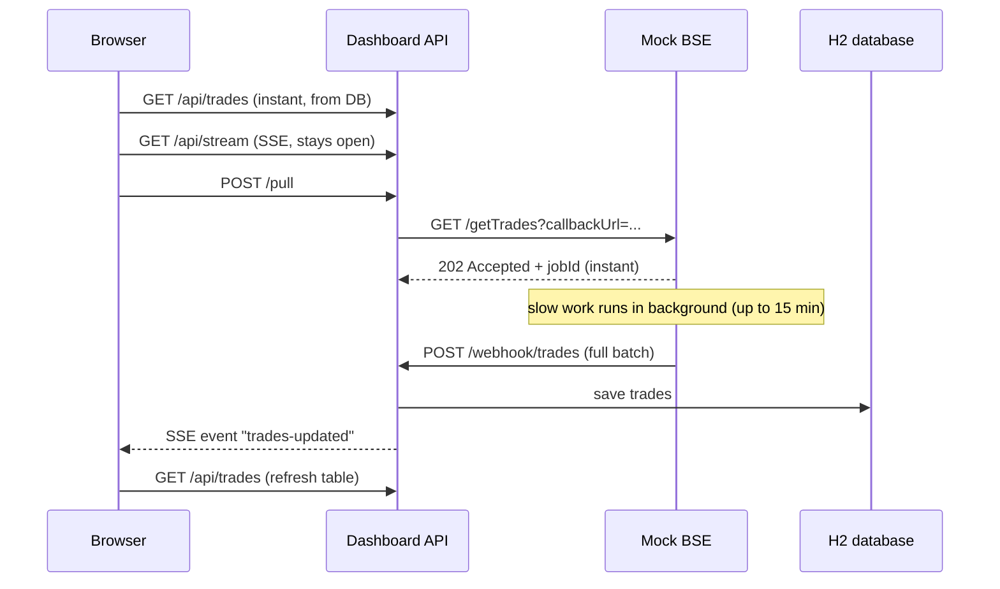

# Architecture

## Why this design

- **No connection is ever held for 15 minutes.** The pull request is
  acknowledged immediately and the result is delivered by callback, so the
  30-second network limit never applies to the slow part.
- **The database is the source of truth.** The dashboard reads stored
  trades, so it opens instantly even while a pull is running.
- **SSE instead of polling.** The server pushes an event when new data
  lands, so there is no polling loop and no scheduler.
- **Known trade-off:** the SSE connection is long-lived, so a network with a
  30-second limit can drop it. The browser's EventSource reconnects
  automatically, and the page reloads from the database on every reconnect
  (`source.onopen`), so no update is lost.
